# Отчёт по практической работе №6

**Тема:** Написание пользовательских сценариев и их отражение в коде.  
**Выполнил:** Малинин Константин Николаевич.  
**Группа:** М-25 ИО.  
**Дата:** 18.11.2026.  
**Номер работы:** 6.

## 1. Цель и полученный результат

Цель работы — пройти цепочку «требование → пользовательский сценарий → модуль → заглушка → реализация → тест → Issue» и обеспечить проверяемую связь между её элементами.

Создан публичный репозиторий <https://github.com/konstmalinin-maker/user-scenarios-demo>. Выполнены основная часть и **все семь дополнительных заданий A–G**. Приложение позволяет добавлять, просматривать, искать, редактировать и удалять заметки. Интерфейс — CLI; хранение — JSON либо SQLite. Работа выполнена индивидуально.

Итог: **186 тестов проходят**, покрытие кода приложения `src` — **100% (280 из 280 исполняемых строк)**. Покрытие каждого сценарного модуля и бизнес-сервиса NoteService — 100%. Подтверждены локальный прогон и GitHub Actions в main: [запуск 44258067897](https://github.com/konstmalinin-maker/user-scenarios-demo/actions/runs/44258067897). Скачанный артефакт CI проверен: 186 успешных testcases, отчёт покрытия совпадает с docs/coverage-report.md.

Скриншоты ниже сняты с настоящего окна терминала. Для этапов GitHub показаны сохранённые фактические ответы GitHub CLI/API с URL, состояниями и SHA; для тестов — журналы реального выполнения. Оригиналы PNG, исходные ответы и журналы находятся в docs/pr6-images и docs/evidence. Состояния OPEN, BLOCKED и MERGED зафиксированы в разные моменты работы.

## 2. Репозиторий и архитектура

В корне находятся README с примерами и CI-бейджем, MIT License, Python .gitignore, pyproject.toml и зафиксированные версии инструментов в requirements.txt. Папки src/domain, src/scenarios, src/infrastructure отделяют предметную область, сценарии и адаптеры. Тесты и скрипты проверки находятся в tests и scripts, документация — в docs. Workflow запускается при push и pull_request.

Ниже приведён фактический tree -L 3; служебные кэши, отчёты coverage и каталоги изображений/журналов исключены из вывода для читаемости.

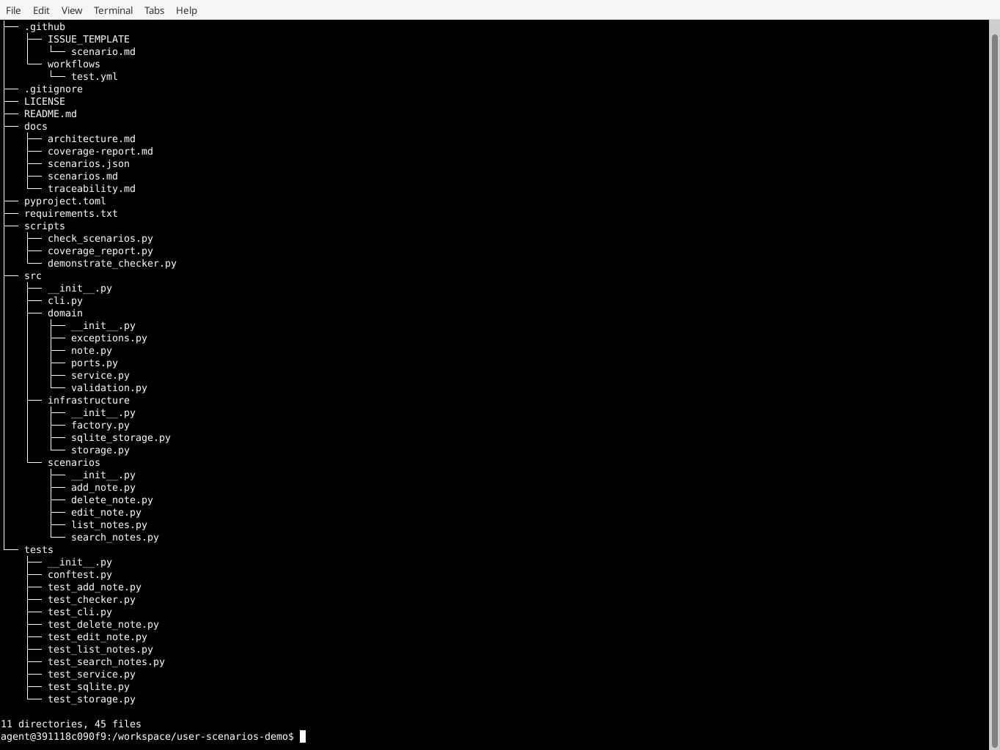

Рисунок 1. Структура репозитория: tree -L 3 с исключением служебных файлов.

Поток вызовов: CLI → функция сценария → NoteService → INoteStorage. JSON- и SQLite-адаптеры реализуют INoteStorage. Сервис получает хранилище через конструктор; правила не зависят от формата сохранения.

Note — неизменяемая dataclass с полным UUID4, заголовком, текстом, created_at и updated_at в UTC. Методы to_dict/from_dict задают сериализацию. Ошибки предметной области представлены DomainError, ValidationError, NoteNotFoundError и StorageError.

JSON сохраняется во временный файл в том же каталоге, выполняются flush/fsync и os.replace. SQLite заменяет снимок внутри транзакции. При сбое записи прежний снимок сохраняется; тест SQLite вызывает реальное нарушение PRIMARY KEY и проверяет rollback.

## 3. Требования и пять сценариев

В docs/scenarios.md заданы базовые FR-001..FR-005, UR-001..UR-005, NFR-002 и NFR-004. Каждый SC имеет User Story, актора, предусловие, триггер, основной поток, альтернативы, постусловие, ссылки на требования, модуль и тестовый файл.

SC-001 — добавление заметки; SC-002 — список новых заметок сверху; SC-003 — поиск по заголовку и тексту без учёта регистра; SC-004 — редактирование; SC-005 — удаление с подтверждением в CLI. Приоритеты: Must для первых двух, Should для поиска и редактирования, Could для удаления.

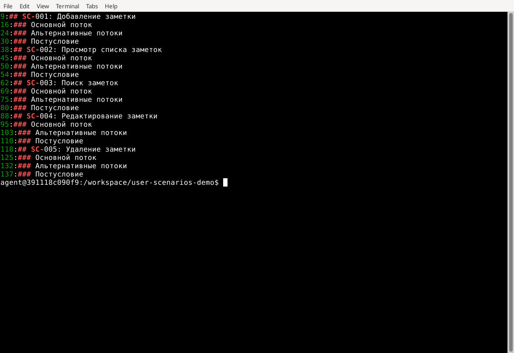

Рисунок 2. В docs/scenarios.md описаны пять сценариев и их потоки.

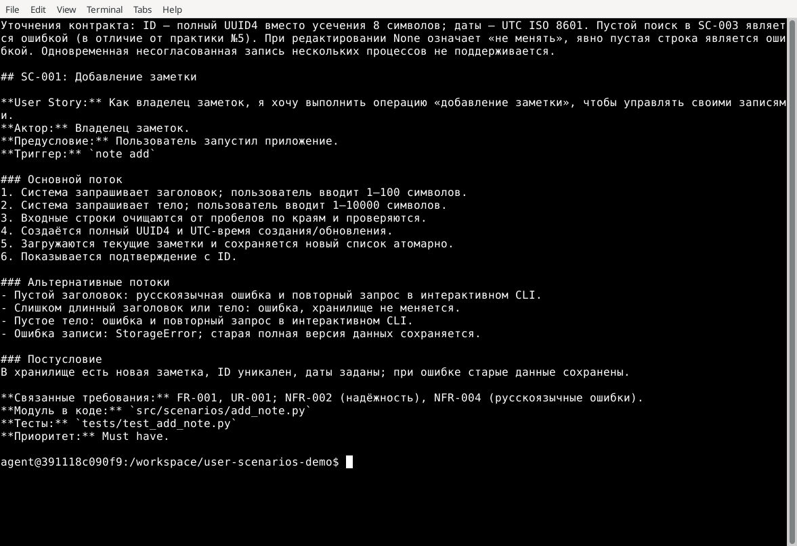

Рисунок 3. Полный формат SC-001: актор, триггер, основной и альтернативные потоки.

Контракты уточнены до реализации: после strip заголовок должен иметь 1–100 символов, тело — 1–10000. Пустой поиск является ошибкой. Поиск использует Unicode casefold. В edit значение None означает «не менять»; явно пустой флаг недопустим. Если оба поля пропущены, операция не записывает данные и не меняет updated_at. Неизвестный ID проверяется до подтверждения удаления; отказ и EOF отменяют удаление.

Созданы Issues #1–#5 с меткой scenario и priority: must / should / could. Для новых задач добавлен шаблон .github/ISSUE_TEMPLATE/scenario.md. После реализации и merge связанные Issues закрылись, чек-листы отмечены выполненными.

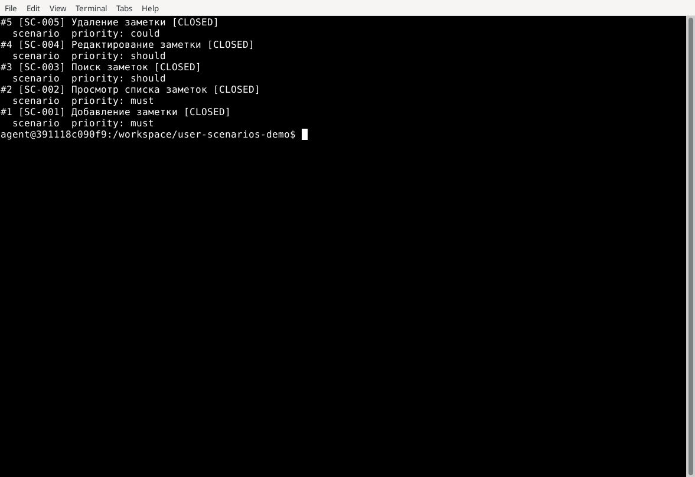

Рисунок 4. Пять Issues с приоритетами и состоянием CLOSED после реализации.

## 4. Этап заглушек и история коммитов

Сначала созданы сущность, исключения, порт хранилища и JSON-адаптер. Затем каждый из пяти сценарных модулей зафиксирован отдельным Conventional Commit с Refs #N. Модули содержали типизированные сигнатуры, docstring с SC-ID, осмысленные TODO и raise NotImplementedError. Заглушка добавления включала также validate_title и validate_body.

Подлинный промежуточный этап сохранён тегом [pr6-stubs](https://github.com/konstmalinin-maker/user-scenarios-demo/tree/pr6-stubs), коммит 5011e1e. Отдельные коммиты заглушек: SC-001 — 3b76832, SC-002 — 39e1c3b, SC-003 — 575ad43, SC-004 — 2fa46d6, SC-005 — 5011e1e. Refs связывал изменение с задачей, оставляя её открытой.

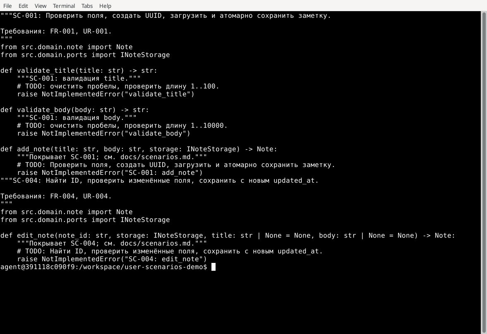

Рисунок 5. Настоящие заглушки SC-001 и SC-004 из тега pr6-stubs.

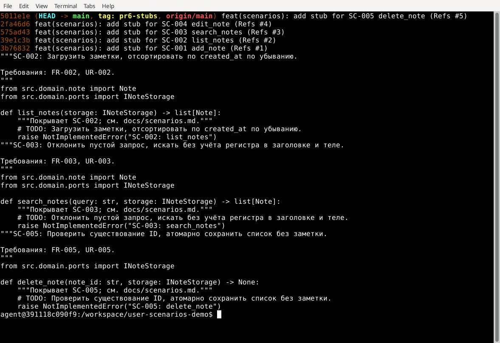

Рисунок 6. Заглушки SC-002, SC-003, SC-005 и отдельные коммиты Refs.

На промежуточном этапе отдельный тест проверял, что оставшиеся заглушки действительно вызывают NotImplementedError. Это проверка состояния заготовок, а не реализация сценариев. В метриках такие строки явно обозначались «заглушка». После завершения всех пяти сценариев временные проверки удалены. В финальном коде сценариев NotImplementedError отсутствует.

## 5. Полная реализация SC-001

В ветке feature/SC-001-add-note реализованы валидация, создание Note с UUID и временем UTC, загрузка снимка, добавление и атомарное сохранение. Ошибки передаются как исключения предметной области. Входные данные проверяются до обращения к хранилищу.

Исходная реализация add_note.py сохранена в коммите 1c418f4 и PR #6. После задания C правила перенесены в NoteService, а публичные функции сценариев сохранены как тонкие обёртки.

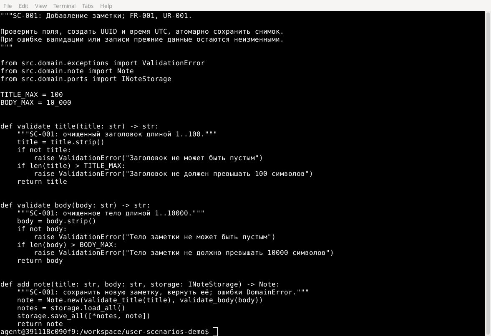

Рисунок 7. Реализованный add_note.py до рефакторинга C.

В tests/test_add_note.py написано **20 отдельных тестовых функций** (больше требуемых 13): успешное сохранение, strip обоих полей, пустые/пробельные значения, длины 1, 100, 101 и 10000, 10001, UUID4, UTC-время, сохранение старых записей, ошибка чтения/записи, неизменность данных при отказе. В финале каждая функция выполняется на JSON и SQLite, поэтому SC-001 даёт 40 testcases.

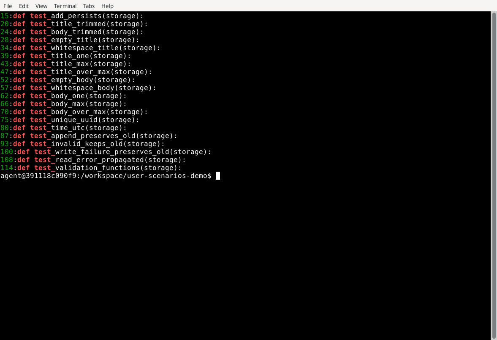

Рисунок 8. Все двадцать тестовых функций SC-001 с номерами строк.

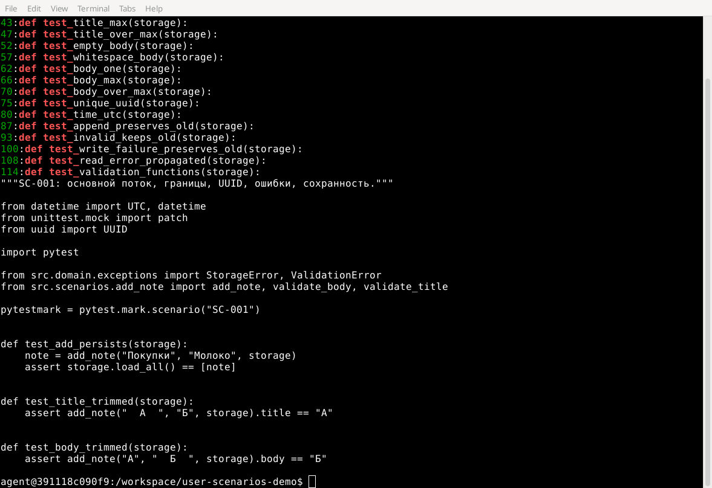

Рисунок 9. Файл test_add_note.py: импорты, маркер SC-001 и примеры проверок.

После пяти Issues первый Pull Request получил номер **#6**. В его описании указано Closes #1. Сначала сохранено состояние OPEN и успешные проверки, затем PR слит merge-коммитом 9327ef8. Issue #1 автоматически перешёл в CLOSED; сохранены ссылки на PR и связанные коммиты.

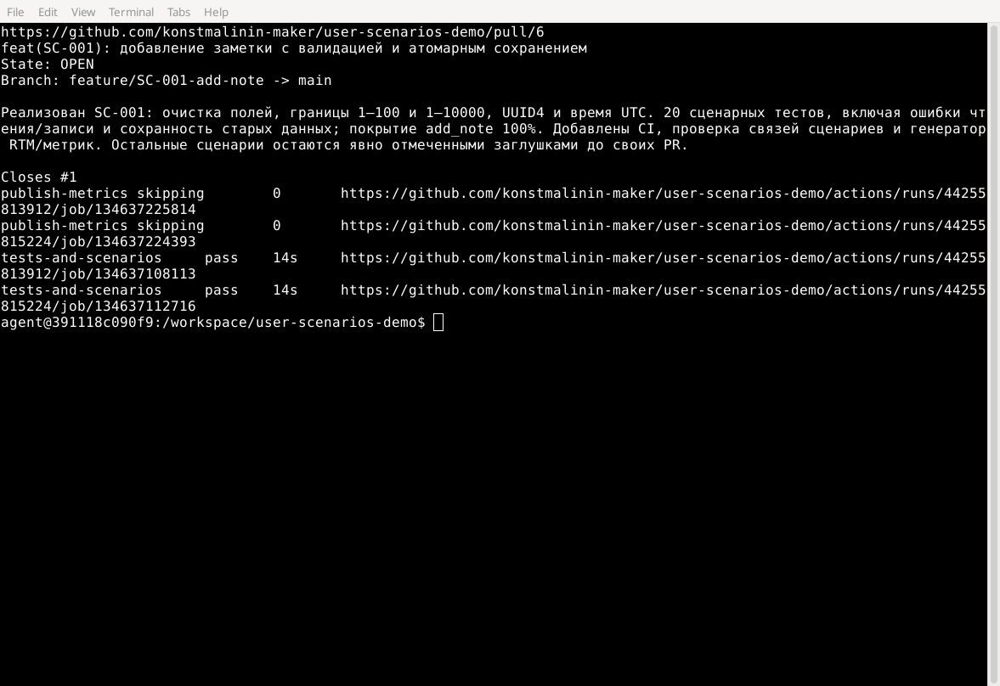

Рисунок 10. PR #6 открыт: feature-ветка, Closes #1 и успешные проверки CI.

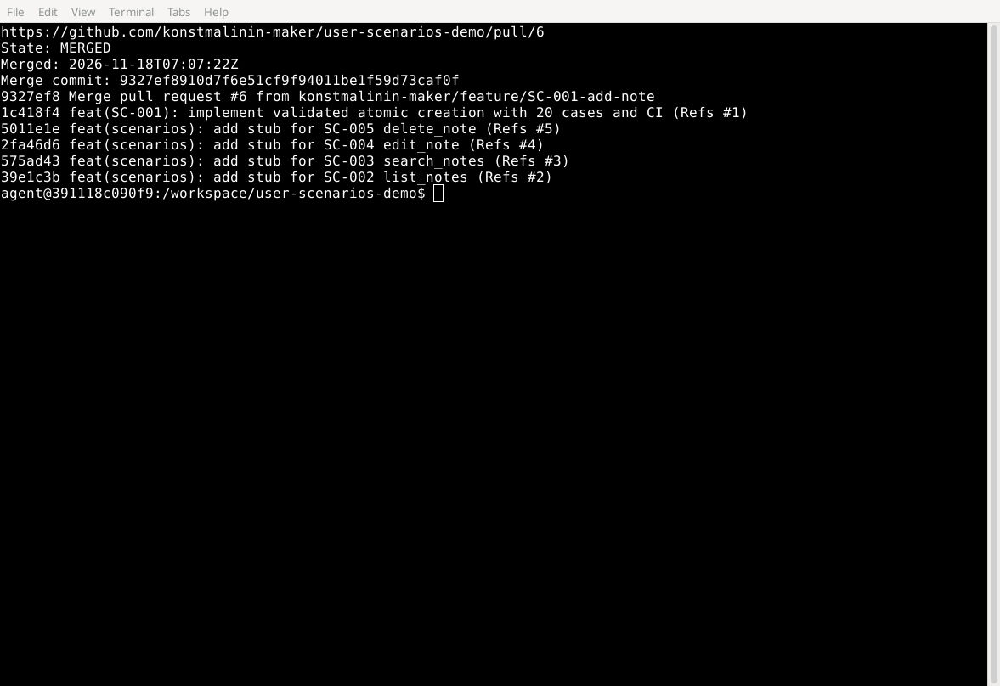

Рисунок 11. PR #6 после слияния: MERGED и merge-коммит 9327ef8.

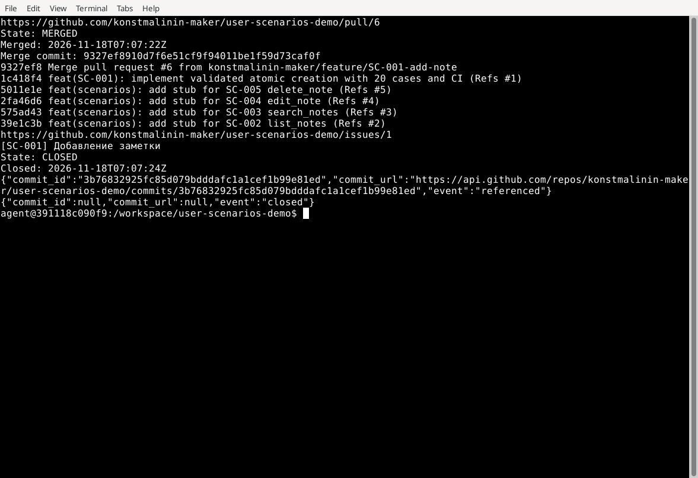

Рисунок 12. Issue #1 закрыт после merge; ссылки на PR, SHA и событие referenced.

## 6. Допзадание A: остальные сценарии и матрица связей

SC-002..SC-005 полностью реализованы в отдельных feature-ветках и PR #7..#10 с Closes #2..#5. В каждом PR проверены основной и альтернативные потоки, ошибки хранилища и порог ≥90%. После каждого merge workflow повторно строит RTM и метрики. Реализации до рефакторинга C сохранены тегом [pr6-five-scenarios](https://github.com/konstmalinin-maker/user-scenarios-demo/tree/pr6-five-scenarios).

В следующей таблице модули находятся в src/scenarios/, тесты — в tests/. Коммит указывает на исходную реализацию соответствующего сценария; последующий общий рефакторинг — 94ae6ab в PR #11.

| SC | Модуль | Issue / PR | Коммит | Тест | Покрытие |
|---|---|---|---|---|---:|
| SC-001 | add_note.py | [#1](https://github.com/konstmalinin-maker/user-scenarios-demo/issues/1) / [#6](https://github.com/konstmalinin-maker/user-scenarios-demo/pull/6) | [1c418f4](https://github.com/konstmalinin-maker/user-scenarios-demo/commit/1c418f4ce3a58181d28285217772cc556d321548) | test_add_note.py | 100% |
| SC-002 | list_notes.py | [#2](https://github.com/konstmalinin-maker/user-scenarios-demo/issues/2) / [#7](https://github.com/konstmalinin-maker/user-scenarios-demo/pull/7) | [a06958f](https://github.com/konstmalinin-maker/user-scenarios-demo/commit/a06958fb8fd4e866a72103e2f4e0bea11f866cfb) | test_list_notes.py | 100% |
| SC-003 | search_notes.py | [#3](https://github.com/konstmalinin-maker/user-scenarios-demo/issues/3) / [#8](https://github.com/konstmalinin-maker/user-scenarios-demo/pull/8) | [df88d77](https://github.com/konstmalinin-maker/user-scenarios-demo/commit/df88d773d9e5c0cb9e6a3f7a3b77b49a82a06657) | test_search_notes.py | 100% |
| SC-004 | edit_note.py | [#4](https://github.com/konstmalinin-maker/user-scenarios-demo/issues/4) / [#9](https://github.com/konstmalinin-maker/user-scenarios-demo/pull/9) | [3759417](https://github.com/konstmalinin-maker/user-scenarios-demo/commit/3759417a0d4f126687a55431e03bc7cd4a546ef3) | test_edit_note.py | 100% |
| SC-005 | delete_note.py | [#5](https://github.com/konstmalinin-maker/user-scenarios-demo/issues/5) / [#10](https://github.com/konstmalinin-maker/user-scenarios-demo/pull/10) | [733377e](https://github.com/konstmalinin-maker/user-scenarios-demo/commit/733377e95a3433cb37aa5acad1e48333b68c1c68) | test_delete_note.py | 100% |

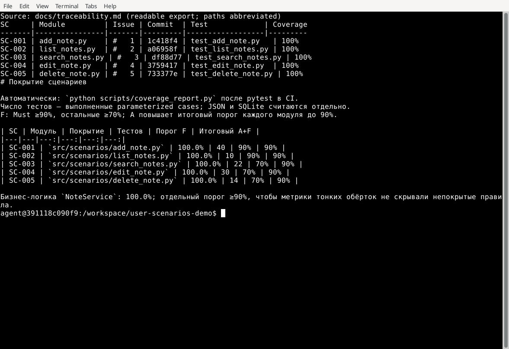

Рисунок 13. Читаемый экспорт RTM и автоматически формируемая таблица покрытия F.

## 7. Допзадание B: CLI

src/cli.py использует argparse и команды note add, list, search, edit, delete. Установка editable через pip создаёт команду note; без установки можно вызывать python -m src.cli. CLI выполняет ввод/вывод и вызывает соответствующие сценарии, а валидация, поиск и изменение данных остаются в предметном слое.

Добавление поддерживает флаги --title/--body и интерактивный ввод с повторным запросом при ValidationError. В edit Enter сохраняет поле. Перед delete выполняется поиск ID, затем запрашивается подтверждение «да» или «yes». Отказ и EOF сохраняют данные. Ожидаемые ошибки выводятся на русском без traceback с кодом 2; успех и отмена — код 0.

Интеграционные тесты используют реальные subprocess и отдельные временные файлы. Проверены все команды, оба адаптера, русские сообщения, поиск, неизвестный ID до запроса подтверждения, отмена/EOF, повторный ввод, интерактивное редактирование и справка. README содержит команды установки и использования.

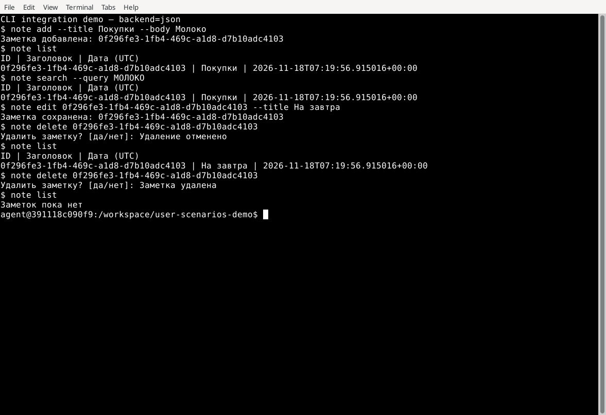

Рисунок 14. Фактический CLI-прогон с JSON: пять команд, отмена и подтверждение удаления.

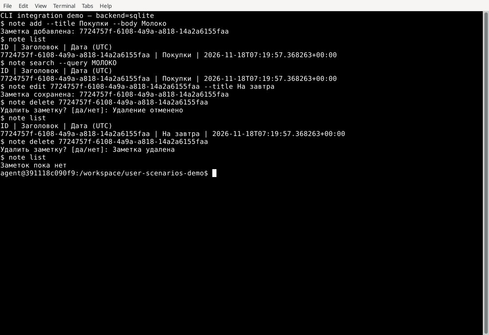

Рисунок 15. Те же операции CLI с SQLite через переменные окружения.

## 8. Допзадание C: конструкторное внедрение зависимости

После пяти самостоятельных реализаций выполнен отдельный рефакторинг. NoteService принимает storage: INoteStorage в __init__ и предоставляет add, list, search, edit, delete; метод get используется интерфейсом для проверки существования перед диалогом. Сценарные функции сохранили сигнатуры и вызывают методы сервиса. Общая валидация вынесена в src/domain/validation.py.

В tests/test_service.py используется create_autospec(INoteStorage, instance=True). Проверены сохранение нового снимка, отсутствие I/O при невалидном вводе, отсутствие записи в read-операциях, ошибка неизвестного ID, контракт delete и неизменность старого снимка при неудачном edit. Файлы и SQLite в этих тестах не нужны.

Это применение DIP: высокоуровневый сервис зависит от абстракции, и адаптеры тоже зависят от этого контракта. Dependency Injection — способ передать нужную реализацию извне через конструктор. Он позволяет заменить JSON на SQLite либо mock без изменения правил предметной области.

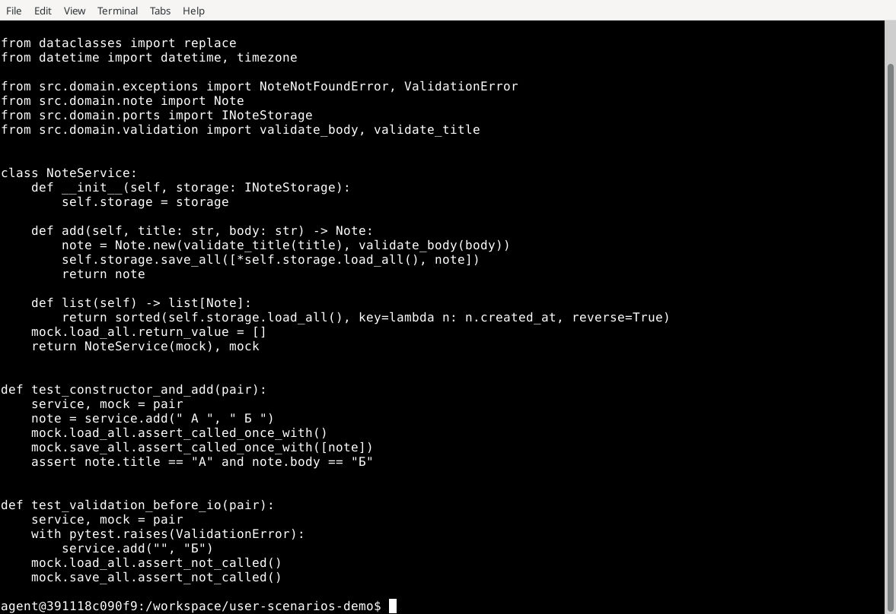

Рисунок 16. NoteService со storage в конструкторе и тесты вызовов mock-хранилища.

## 9. Допзадание D: CI и реальная блокировка PR

Workflow .github/workflows/test.yml запускает Ruff, проверку связей E, pytest-cov с общим порогом 80% и генератор метрик F при push и PR. В README добавлен CI-бейдж. Задание tests-and-scenarios выбрано обязательной проверкой ветки main.

Для демонстрации в PR #11 добавлен отдельный коммит **cd00f14** с временным падающим тестом. В GitHub Actions [44257801347](https://github.com/konstmalinin-maker/user-scenarios-demo/actions/runs/44257801347) зафиксировано **1 failed, 186 passed**. Статус PR стал BLOCKED. Реальная команда gh pr merge 11 --merge была отклонена политикой базовой ветки с кодом 1; текст отказа сохранён в docs/evidence/ci-merge-blocked.txt. Таким образом, проверено именно запрещённое слияние при красном CI, а не только наличие ошибки в логе.

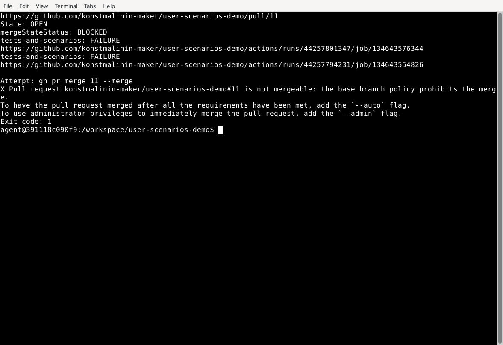

Рисунок 17. Падающий required check, состояние BLOCKED и отклонённая попытка merge.

Затем коммитом **1cd259f** временная ошибка удалена. Проверки снова прошли, PR получил CLEAN и слит коммитом 83e7320. В финальном состоянии временного теста нет. Журналы падения, восстановления и API-снимки сохранены; main успешно проверен отдельно.

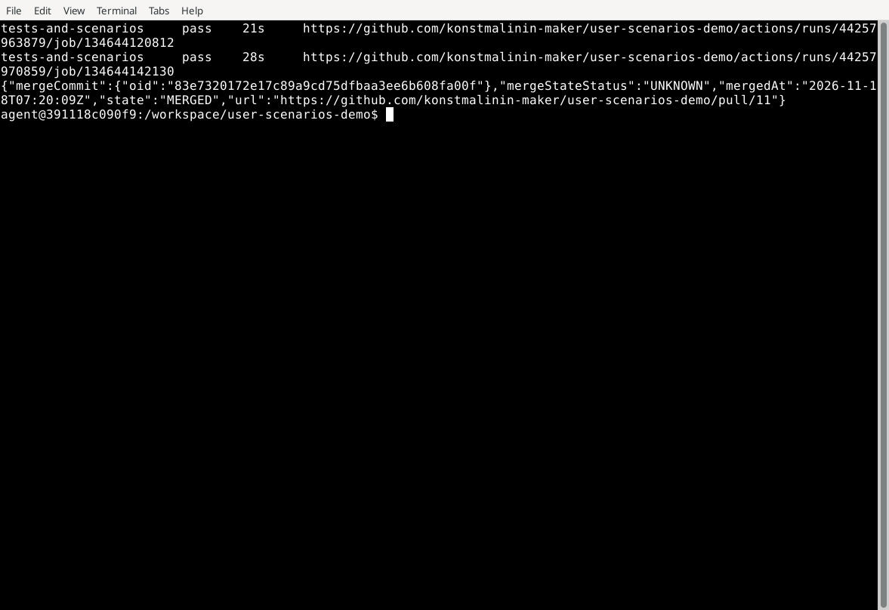

Рисунок 18. После исправления проверки зелёные, PR #11 слит в main.

## 10. Допзадание E: автоматическая связь сценария и кода

scripts/check_scenarios.py извлекает определения SC-ID из заголовков docs/scenarios.md и сверяет их с docs/scenarios.json. Для каждого сценария проверяются наличие модуля, SC-ID в module docstring, наличие тестового файла и SC-ID в его docstring. AST-проверка дополнительно требует настоящие test_-функции у реализованных сценариев и запрещает оставшиеся NotImplementedError. Ошибка даёт exit code 1. Скрипт вызывается в CI.

Демонстрация scripts/demonstrate_checker.py работает с временной копией проекта: корректная копия даёт код 0; удаление модуля, удаление теста и удаление SC-ID из каждого из этих файлов дают код 1; восстановление возвращает код 0. Набор tests/test_checker.py также проверяет неизвестный SC-ID, синтаксическую ошибку, отсутствие test_-функций и оставшуюся заглушку.

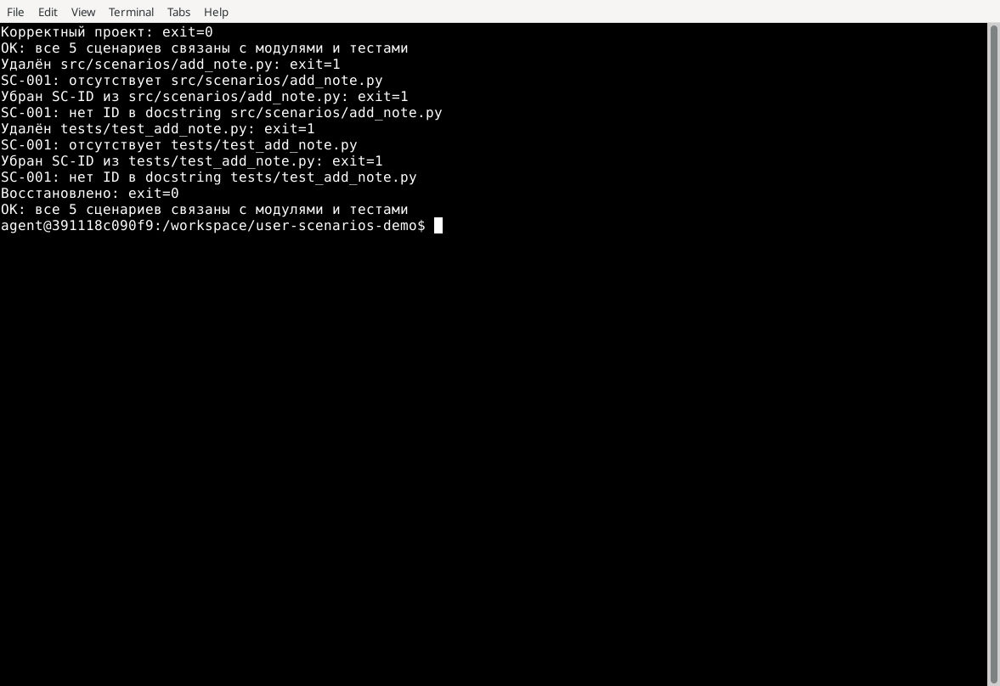

Рисунок 19. Реальные exit codes проверки E: нарушения обнаружены, восстановление успешно.

## 11. Допзадание F: покрытие сценариев

scripts/coverage_report.py читает coverage.json и фактически выполненные testcases из junit.xml. Он автоматически перезаписывает docs/coverage-report.md и docs/traceability.md в CI. Текущие файлы вместе с JSON/XML/HTML покрытия публикуются артефактом scenario-metrics каждого успешного запуска. В Git хранится проверенный снимок, совпадающий с артефактом main; прямые bot-push в защищённую ветку не требуются.

Порог F — 90% для Must и 70% для остальных. Поскольку A требует ≥90% каждого модуля, итоговый обязательный порог всех сценариев установлен 90%; оба порога показаны в таблице. После рефакторинга дополнительно контролируется ≥90% NoteService, чтобы тонкие обёртки не скрывали непокрытые правила.

Итоговые testcases: SC-001 — 40, SC-002 — 10, SC-003 — 22, SC-004 — 30, SC-005 — 14. Это **116 сценарных случаев**, по 58 на каждом адаптере. Остальные тесты проверяют CLI, сервис с mock, адаптеры и проверку трассируемости. Всего — 186.

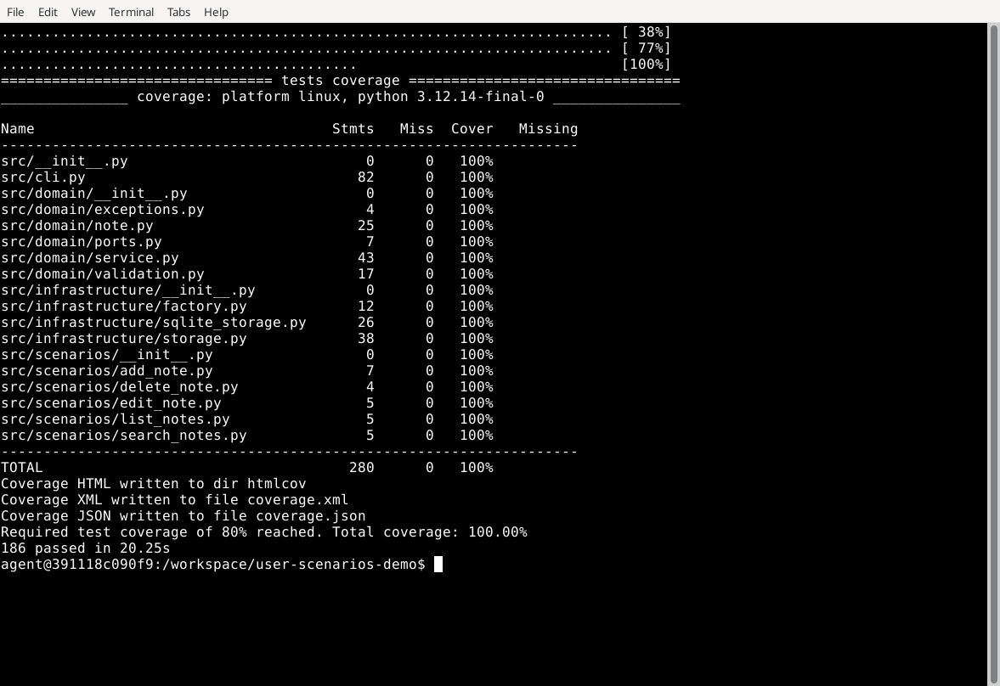

Рисунок 20. Финальный прогон: 186 passed, покрыто 280 из 280 строк src.

## 12. Допзадание G: SQLite и DIP

Создан src/infrastructure/sqlite_storage.py с SQLiteNoteStorage(INoteStorage). JSON NoteStorage также реализует этот абстрактный порт. create_storage в infrastructure/factory.py выбирает адаптер по NOTES_BACKEND=json|sqlite; NOTES_PATH задаёт файл. Переключение применяется только в точке сборки CLI, сервис и сценарии не меняются.

Общая фикстура tests/conftest.py имеет params=["json", "sqlite"]. Все тесты пяти сценариев проходят с обеими реализациями; симметрия 58+58 проверена по JUnit. Отдельно проверены повреждённая БД, некорректная запись, rollback после нарушения PRIMARY KEY и выбор бэкенда через окружение. CLI также параметризован по двум адаптерам.

Связь с DIP заключается в замене низкоуровневого механизма без изменения высокоуровневых операций. Переключение файла не переносит записи автоматически: JSON и SQLite используют разные хранилища. Работа рассчитана на одного владельца, без несогласованной параллельной записи нескольких процессов.

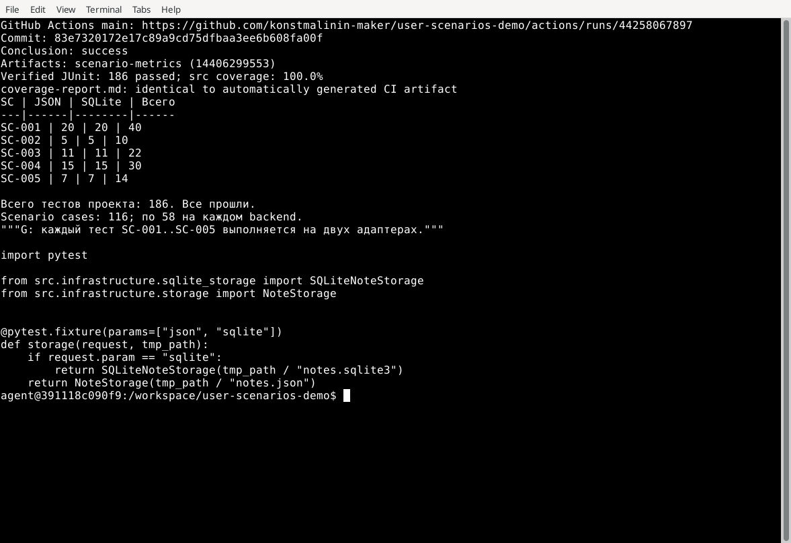

Рисунок 21. Успешный main CI, 58+58 сценарных случаев и общая фикстура JSON/SQLite.

## 13. Ответы на контрольные вопросы

**1. Чем сценарий отличается от функционального требования?** Требование задаёт обязательную возможность системы: например, создавать заметку. Сценарий раскрывает взаимодействие по шагам: кто инициирует действие, что вводит, как система отвечает, что происходит при ошибке и какой результат должен остаться.

**2. Зачем альтернативные потоки?** Они определяют поведение при пустом вводе, неизвестном ID, отказе пользователя и недоступном хранилище. Без них разработчик и тестировщик могут по-разному трактовать ошибочные состояния. В этой работе альтернативы стали отдельными тестами.

**3. Как выбрать имя модуля?** Использовать глагол и предмет операции в snake_case, отражающие цель сценария: add_note.py, search_notes.py. Уникальный SC-ID фиксируется в docstring; имя не должно скрывать назначение за общим utils.py.

**4. Что такое заглушка и зачем она нужна?** Это заготовка с правильной сигнатурой и описанным контрактом, но без основной логики. TODO задаёт следующие шаги, NotImplementedError явно показывает незавершённость. Заглушка помогает согласовать архитектуру и связи до реализации.

**5. Как связать коммит с Issue, чем отличаются Closes и Refs?** В сообщении коммита указывается, например, feat(scenarios): add stub (Refs #1). Refs создаёт ссылку, оставляя задачу открытой. Closes #1 в PR или коммите использует механизм автоматического закрытия. Для заглушек применён Refs, для готовых PR — Closes.

**6. Когда Closes #N реально закрывает Issue?** При попадании связанного изменения в default branch репозитория, обычно после merge PR в main. Само создание feature-ветки или открытие PR задачу не закрывает. В работе Issue #1 закрыт после merge PR #6, что видно в API-событиях.

**7. Что такое матрица трассируемости?** Это таблица связей между требованиями, сценариями, кодом, задачами, коммитами и тестами. Она позволяет найти реализацию требования, увидеть непокрытые участки и оценить последствия изменения. Здесь матрица находится в docs/traceability.md.

**8. Как проверить полноту тестов сценария?** Сопоставить тесты с каждым шагом, альтернативой и постусловием; проверить результаты и побочные эффекты, включая сохранность старых данных. Затем измерить покрытие, выполнить интеграционные тесты и запустить один контракт на обоих адаптерах. Процент покрытия строк сам по себе не доказывает полноту поведения.

**9. Почему важны граничные значения?** Ошибки часто возникают на границе допустимой длины или пустого состояния. Для заголовка проверены 0, пробелы, 1, 100 и 101 символ; для текста — 0, 1, 10000 и 10001. Это проверяет включительность границ и защиту хранилища от невалидной записи.

**10. Что будет при вызове NotImplementedError из теста?** В обычном тесте необработанное исключение приведёт к FAILED и ненулевому коду pytest. Тест, явно ожидающий это исключение через pytest.raises, пройдёт, но подтвердит только контракт заглушки. Поэтому временные проверки заготовок были заменены поведенческими тестами реализации.

## 14. Трудности и решения

Создание репозитория и настройка защиты ветки оказались недоступны GitHub-интеграции (HTTP 403). Владелец создал пустой публичный репозиторий и включил обязательный tests-and-scenarios; после этого блокировка подтверждена фактическим отказом merge.

При переносе правил в сервис важно было сохранить контракты функций и не принять покрытие обёрток за проверку бизнес-логики. Решение — прежние сценарные тесты на двух адаптерах, отдельные mock-тесты и дополнительный порог NoteService.

Для CLI требовалось учитывать дочерние процессы в coverage. Использован механизм coverage patch=subprocess, поэтому в отчёт вошло выполнение команд через subprocess. Проверены также EOF и повторный ввод, а сохранение данных при отказе и ошибке подтверждено отдельно.

Сохранить историю разработки помогли отдельные коммиты, merge без squash и теги pr6-stubs / pr6-five-scenarios. Для каждого утверждения об этапах приложены SHA, ссылки, журналы и снимки реального окна.

## 15. Воспроизведение и состав комплекта

```bash
python -m venv .venv
source .venv/bin/activate
python -m pip install -r requirements.txt
python -m pip install -e .
ruff check .
python scripts/check_scenarios.py
python -m pytest -q --cov=src --cov-report=term-missing --cov-report=json --cov-fail-under=80 --junitxml=junit.xml
python scripts/coverage_report.py
python scripts/demonstrate_checker.py
```

В Windows вместо source используется .venv\Scripts\Activate.ps1. Подробные команды CLI и переменные окружения приведены в README.

Полный комплект включает Markdown-отчёт, DOCX со встроенными изображениями, 21 оригинальный PNG, исходники, тесты, сценарии, RTM, workflow, журналы и исходные данные проверки. Git bundle сохраняет коммиты, ветки и теги; восстановление: git clone PR6_user-scenarios-demo.bundle user-scenarios-demo. Отдельно приложен архив скриншотов. Проверенный артефакт CI включён в папку verification/ полного комплекта.
